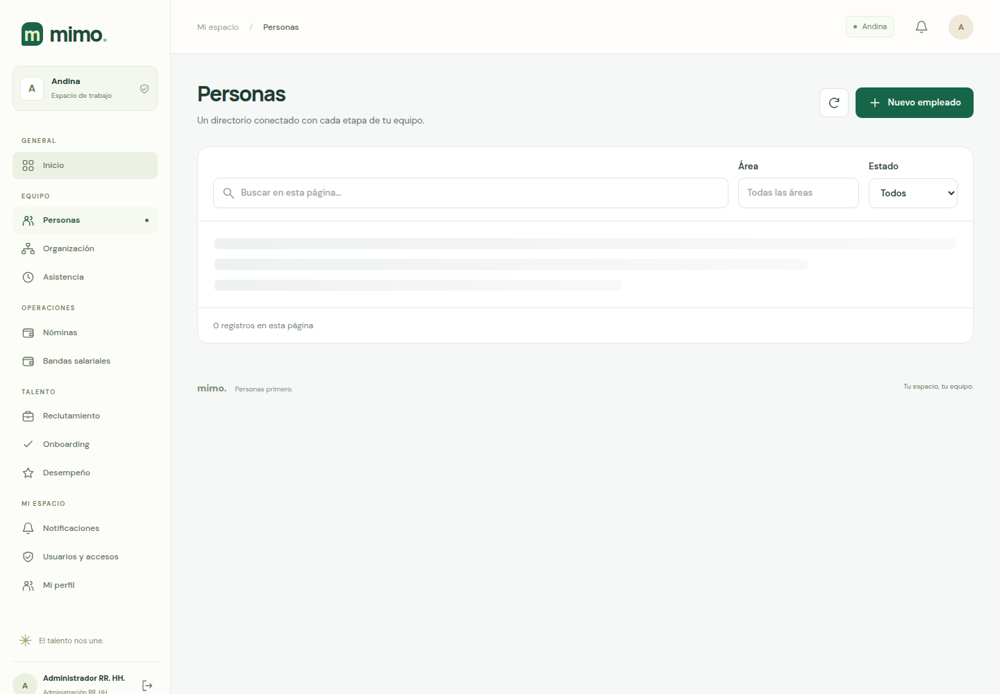
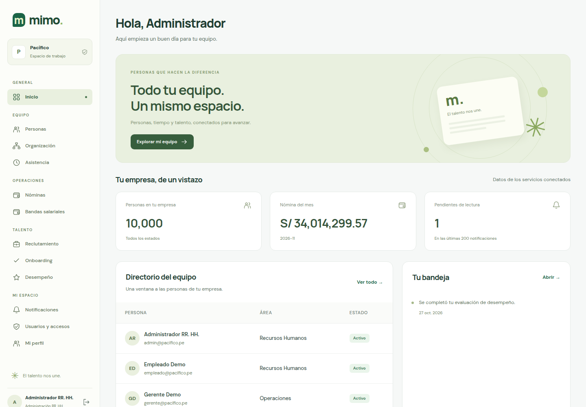

# Demostración real de multitenencia

Sitio: https://main.d2d9bbvg1i7lcp.amplifyapp.com

Se abrió la misma aplicación en dos sesiones independientes. Las comprobaciones fueron de solo lectura; no se crearon ni modificaron empleados.

| Sesión | Correo de demostración | Empresa mostrada | Empleados |
|---|---|---|---:|
| A | `admin@andina.pe` | Andina | 10 005 |
| B | `admin@pacifico.pe` | Pacífico | 10 000 |

La contraseña de ambas cuentas de demostración es `Demo1234!`. Abre dos pestañas, inicia una sesión diferente en cada una y entra a **Inicio** y **Personas**. El nombre de la empresa aparece en la barra superior y en el espacio de trabajo lateral. Cada sesión permanece en memoria; recargar la página requiere ingresar otra vez.

## Andina

[Ver inicio de Andina](andina-inicio.png).

## Pacífico

[Ver inicio de Pacífico](pacifico-inicio.png).

## Pruebas de separación

- El JWT de cada cuenta contiene su propio `tenant_id`.
- `GET /empleados/me` devuelve una ficha diferente en cada sesión. Ambas pueden tener `empleado_id=emp-000001`: la empresa también forma parte de la identidad del registro. Los correos son `admin@andina.pe` y `admin@pacifico.pe`.
- Agregar `?tenant_id=pacifico` usando la sesión de Andina conserva la ficha de Andina. La empresa proviene de la sesión validada.
- Usar en Pacífico un token de paginación de conceptos de Andina devuelve **HTTP 400**.
- Cambiar `tenant_id` en el contenido de un JWT sin generar una firma válida devuelve **HTTP 401**.

[Resultados originales con fecha y códigos HTTP](verificacion.json).

Esto demuestra multitenencia lógica: las empresas comparten aplicación e infraestructura y se separan por tenant. Estas pruebas concretas de Usuarios, Empleados y Nóminas no equivalen a una auditoría exhaustiva de todos los endpoints o roles.
