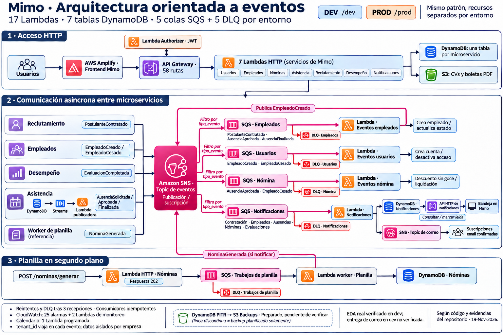

# HCM: un servicio Serverless

## Diagrama de arquitectura y eventos



El topic SNS distribuye eventos a cuatro colas de consumidores. La quinta cola recibe directamente los trabajos de planilla desde la Lambda HTTP. Cada cola tiene su DLQ. Notificaciones guarda los avisos en DynamoDB para la app y publica en un topic SNS de correo con suscripciones confirmadas. El diagrama representa el patrón de cada entorno; los recursos de dev y prod son independientes.

La configuración del servicio `hcm` reduce las 68 Lambdas anteriores a **17 por entorno**: siete HTTP, seis consumidores SQS/Streams, un calendario, un authorizer y dos de monitorización. Las 58 rutas HTTP conservan sus URLs y las reglas de cada handler. **Desplegado en AWS y verificado en dev antes de continuar con prod.** Cada stage tiene una REST API y un authorizer compartido.

| Módulo | Antes | Ahora |
|---|---:|---:|
| Usuarios | 11 | 3 |
| Empleados | 11 | 2 |
| Nóminas | 15 | 3 |
| Asistencia | 13 | 3 |
| Reclutamiento | 8 | 1 |
| Desempeño | 4 | 1 |
| Notificaciones | 4 | 2 |
| Monitorización | 2 | 2 |

Cada Lambda `<modulo>_http` usa el despachador `hcm_http.handler` y un mapa `hcm_routes.json` incluido en su ZIP. Se selecciona el handler por `httpMethod` y `resource` de API Gateway REST; no por el body o una ruta elegida por el cliente. Se conservan parámetros, consultas, respuestas binarias y contexto del autorizador. Las rutas públicas siguen siendo públicas; las demás mantienen su authorizer y el router exige tenant, usuario y rol antes de despachar. La autorización de roles continúa en los handlers originales. Cada grupo usa el mayor timeout HTTP de su módulo; los workers conservan el suyo (900 segundos para planillas).

## Pruebas y migración de Lambdas

Después de `python3 hcm/build.py --stage dev`, ejecutar `python3 -m unittest discover -s hcm/tests -v`. Las pruebas recorren las 58 rutas y ejecutan casos de las 17 funciones con handlers reales y AWS simulado, usando los ZIPs extraídos como en Lambda. También comparan las diez funciones no HTTP con la configuración anterior y comprueban el secreto JWT durante la migración. No equivalen a pruebas extremo a extremo en AWS. La suite completa de usuarios/empleados/asistencia requiere además pytest y moto según sus requirements. [Resultados y límites de verificación](../docs/lambdas_agrupadas.md).

`deploy.py` obtiene el secreto de `usuarios_http` si ya existe; en la primera migración lo recupera de `usuarios_login`. Un error de permisos no genera otro secreto. Antes del despliegue, revisar el change set, conservar los logs HTTP anteriores que sean necesarios y probar primero en dev. La actualización cambia las integraciones y retira las 58 funciones HTTP antiguas; puede haber un intervalo de errores mientras CloudFormation actualiza rutas y permisos. La migración no requiere editar el frontend ni las tablas. La agrupación y la separación de recursos de dev se aplicaron conjuntamente después del respaldo S3 y la revisión de los change sets.

| Stage | Stack / nombre en API Gateway | URL |
|---|---|---|
| dev | `hcm-dev` / `dev-hcm` | https://mwxvk1jpd3.execute-api.us-east-1.amazonaws.com/dev |
| prod | `hcm-prod` / `prod-hcm` | https://ex9aeywwi7.execute-api.us-east-1.amazonaws.com/prod |

## Datos separados por entorno (desplegado)

Producción conserva las siete tablas originales y sus registros. Sus nombres históricos incluyen `-dev` en varios módulos, pero no se comparten con la nueva configuración de pruebas. No se renombran ni eliminan tablas para evitar migraciones de datos.

| Módulo | Pruebas (`dev`), nuevas | Producción (`prod`), existentes |
|---|---|---|
| Usuarios | `hcm-dev-usuarios` | `hcm-usuarios` |
| Empleados | `hcm-dev-empleados` | `hcm-empleados` |
| Nóminas | `hcm-dev-nominas` | `hcm-nominas-dev` |
| Asistencia | `hcm-dev-asistencia` | `hcm-asistencia-dev` |
| Reclutamiento | `hcm-dev-reclutamiento` | `hcm-reclutamiento-dev` |
| Desempeño | `hcm-dev-desempeno` | `hcm-desempeno-dev` |
| Notificaciones | `hcm-dev-notificaciones` | `hcm-notificaciones-dev` |

Cada entorno tiene sus propios consumidores y tareas, conectados a sus propias colas, streams, buckets y topics. Pruebas crea todos esos recursos, sin apuntar a los originales; producción conserva los originales y su suscripción de correo. Los secretos JWT siguen separados. Las tablas nuevas incluyen PITR y políticas de retención; para las originales se conservan sus propiedades actuales.

**Dev y prod ya utilizan datos separados.** Las tablas de pruebas se crearon vacías y solo se registró una empresa ficticia para la verificación; no se copió información personal de producción. Crear la primera empresa mediante el registro de pruebas o cargar datos ficticios apuntando explícitamente a las nuevas tablas. El frontend de pruebas debe compilarse con `VITE_API_URL` de dev; el frontend productivo debe seguir usando prod.

Antes de modificar el stack dev, realizar un backup y revisar el change set: debe añadir los recursos de pruebas, sin eliminar ni reemplazar tablas/buckets originales. Evitar operaciones de negocio mientras termina la actualización de las funciones de dev. No desplegar los módulos antiguos por separado ni volver a activar sus consumidores.

[Respaldo directo a S3 desde una VM](../backup/README.md).

## Construir y desplegar

```sh
python3 -m venv /tmp/hcm-build
/tmp/hcm-build/bin/pip install -r hcm/requirements-build.txt
npm ci --prefix ms-notificaciones
/tmp/hcm-build/bin/python hcm/deploy.py --stage dev
/tmp/hcm-build/bin/python hcm/deploy.py --stage prod
python3 -m unittest discover -s hcm/tests -v
```

Requiere credenciales AWS y Serverless Framework disponibles. `deploy.py` descubre los recursos originales para prod (dev crea recursos propios) y recupera el secreto del stage desplegado en memoria; genera uno al primer despliegue. Usa el rol `LabRole` de la cuenta o `LAB_ROLE_ARN`. Nunca imprimir secretos ni versionar las plantillas resueltas: `.runtime`, `.build` y `.serverless` son privadas y están ignoradas por Git.

Para construir pruebas sin desplegar, ejecutar `python3 hcm/build.py --stage dev`. Para producción, ejecutar primero `python3 hcm/existing.py --stage dev` y después `python3 hcm/build.py --stage prod`; el manifiesto original solo es obligatorio para prod. Los ocho ZIPs separados conservan los imports y dependencias de cada módulo; la configuración intermedia de los tests no es un despliegue de tablas nuevas.

Los `serverless.yml` originales son entradas del generador. **No desplegar los módulos individualmente**: volvería a crear sus APIs y consumidores. Los stacks originales conservan la propiedad de las tablas y recursos de producción; son infraestructura activa y no deben eliminarse. `legacy.py` pausa consumidores, guarda un plan privado y retira solo ejecución/API con protección contra borrado o reemplazo de los recursos conservados.

## Compatibilidad

Se conservan rutas, permisos, paginación y reglas de negocio. El frontend usa una sola `VITE_API_URL`, predeterminada a prod. Los pings duplicados se distinguen como `/empleados/ping`, `/asistencia/ping` y `/notificaciones/ping`; usuarios conserva `/ping`.

[Evidencia de verificación](../docs/hcm_unificado_verificacion.json).

## Verificación del despliegue · 17-Nov-2026 (Lima)

Ambos stacks están en `UPDATE_COMPLETE`, con 17 funciones activas, seis mappings habilitados y 25 alarmas con acciones activas por entorno. Dev se verificó antes del inicio de la actualización de prod. Los change sets no eliminaron ni reemplazaron recursos de datos; se conservó el secreto JWT de cada stage. Los prototipos vacíos de dev que no pertenecían al stack se comprobaron vacíos y se retiraron para que CloudFormation pudiera crearlos y gestionarlos.

La revisión encontró mappings de prod deshabilitados fuera de la plantilla, incluido un stream con un error de permisos del laboratorio anterior. Se reactivaron sin consumidores duplicados y el monitor confirmó los seis canales habilitados. Tras reiniciar AWS Academy, revisar nuevamente estos canales: un despliegue puede conservar un estado deshabilitado cambiado fuera de CloudFormation.

[Evidencia de dev](../docs/lambdas_dev_verificacion.json) y [prod](../docs/lambdas_prod_verificacion.json). La verificación inicial con lotes vacíos se amplió con el [EDA real de dev](../docs/eda_dev_real.md): los seis consumidores procesaron contratación, creación de usuario, ausencia, descuento, planilla y notificaciones. Se verificaron boleta PDF en S3, aislamiento entre empresas y reentrega sin duplicar descuentos o avisos. En prod las comprobaciones siguen siendo de lectura y lotes vacíos; el calendario solo se comprobó con DryRun.
